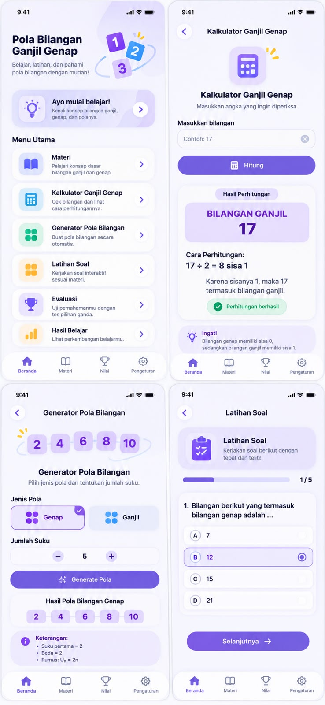

# Polaria — Belajar Pola Bilangan Ganjil & Genap

Aplikasi web pembelajaran matematika untuk siswa SMP kelas VIII pada materi **pola bilangan ganjil dan genap**. Aplikasi dirancang berdasarkan *Cognitive Load Theory* agar materi tersaji bertahap, ringkas, dan visual, sehingga siswa lebih mudah membedakan pola, memilih rumus, dan menerapkannya pada soal cerita (literasi matematika).

Bisa dibuka di **browser** dan **dipasang di smartphone tanpa Play Store atau App Store** (Progressive Web App).



## Identitas

| | |
|---|---|
| Nama | Suchita Rahma Fakhira |
| NIM | 2225250006 |
| Kelas | 3B — S1 Pendidikan Matematika |
| Mata kuliah | Algoritma dan Pemrograman |
| Dosen pengampu | Dr. Aan Hendrayana, S.Si., M.Pd. |

## Latar Belakang Singkat

Wawancara dengan siswa kelas VIII menunjukkan kesulitan terbesar adalah **membedakan pola ganjil/genap dan menentukan rumus**, serta mencari **jumlah suku**. Siswa merasa penjelasan terlalu cepat dan panjang, dan paling terbantu oleh **contoh soal** dan **latihan yang mirip**. Rincian ada di [docs/ANALISIS-KEBUTUHAN.md](docs/ANALISIS-KEBUTUHAN.md).

## Fitur Utama (MVP)

- Masuk cukup dengan **nama dan kelas**
- **Materi** bertahap: pemanasan → mengenal ganjil & genap → pola & rumus Un → jumlah Sn, dengan contoh langkah demi langkah
- **Kalkulator Ganjil Genap**: cek bilangan, lihat cara hitung (17 ÷ 2 = 8 sisa 1) dan posisinya dalam pola
- **Generator Pola Bilangan**: buat pola genap/ganjil, lihat rumus Un dan jumlah Sn
- **Latihan Soal** 3 level dengan soal acak, petunjuk bertahap, dan pembahasan
- **Evaluasi** pre-test & post-test
- **Hasil Belajar**: perkembangan skor per level dan per jenis soal
- Bisa **dipasang di HP** dan tetap bisa belajar saat sinyal putus

## Teknologi

| Bagian | Teknologi |
|---|---|
| Tampilan & aplikasi HP | HTML, CSS, **JavaScript** (PWA: service worker + manifest) |
| Logika matematika (API) | **Python 3.12 + FastAPI** |
| Database & login | [Supabase](https://supabase.com) (Postgres + anonymous sign-in) |
| Hosting | [Vercel](https://vercel.com) (file statis + Python serverless function) |

## Cara Memasang di HP (untuk siswa)

Buka alamat aplikasi (mis. `https://polaria.vercel.app`) di HP, lalu:

**Android (Chrome)**
1. Ketuk tombol **"Pasang Aplikasi"** di Beranda, atau menu ⋮ → **Instal aplikasi / Tambahkan ke layar utama**.
2. Ketuk **Pasang**. Ikon Polaria muncul di layar utama.

**iPhone (Safari)**
1. Ketuk ikon **Bagikan** (kotak dengan panah ke atas).
2. Pilih **Tambahkan ke Layar Utama**, lalu ketuk **Tambah**.

Aplikasi akan terbuka layar penuh seperti aplikasi biasa, tanpa Play Store/App Store.

## Cara Menjalankan (untuk pengembang)

> Tanpa Supabase pun aplikasi sudah bisa dicoba: jika `.env` dibiarkan kosong, data hanya tersimpan di perangkat (mode lokal).

### 1. Siapkan Supabase (untuk menyimpan data siswa ke server)
1. Buat proyek baru di Supabase.
2. Buka **SQL Editor**, jalankan `supabase/schema.sql` (membuat tabel `siswa`, `progres_modul`, `jawaban_latihan`, `hasil_evaluasi` beserta kebijakan RLS).
3. **Authentication → Sign In / Providers**: aktifkan **Anonymous Sign-ins**.
4. **Project Settings → API**: salin **Project URL** dan **anon public key** (atau *publishable key*) ke file `.env` di akar proyek:
   ```env
   SUPABASE_URL=https://xxxx.supabase.co
   SUPABASE_ANON_KEY=eyJ...
   ```
   File `.env` tidak ikut ke GitHub (ada di `.gitignore`). Contohnya ada di `.env.example`.

**Bagaimana nilainya sampai ke aplikasi?** Browser tidak bisa membaca `.env`. API Python membacanya lalu menyerahkan URL dan kunci publik lewat `/api/config`. *Anon key* memang aman dipakai di browser karena data dilindungi RLS. **Jangan** isi `service_role` / *secret key*: API akan menolaknya dan aplikasi kembali ke mode lokal.

### 2. Jalankan lokal
Butuh Python 3.12.
```bash
python -m venv .venv
.venv\Scripts\activate                 # macOS/Linux: source .venv/bin/activate
pip install -r requirements.txt pytest httpx uvicorn
```
Jalankan server (API + file statis sekaligus):
```powershell
$env:LOKAL="1"; uvicorn api.index:app
```
Buka `http://localhost:8000`. Setelah mengubah `.env` atau kode Python, matikan server (Ctrl+C) lalu jalankan lagi.

### 3. Uji
```bash
pytest
```

### 4. Deploy ke Vercel
1. Unggah proyek ke repositori GitHub.
2. Di Vercel: **Add New → Project**, pilih repositori.
3. Framework preset: **Other**; kosongkan *Build Command*. Vercel otomatis memasang Python dari `requirements.txt` untuk `api/index.py`.
4. Buka **Settings → Environment Variables**, tambahkan `SUPABASE_URL` dan `SUPABASE_ANON_KEY` dengan nilai yang sama seperti di `.env` (file `.env` sendiri tidak diunggah).
5. Klik **Deploy**. Setiap `git push` memperbarui situs. Alamat Vercel sudah HTTPS, syarat agar aplikasi bisa dipasang di HP.

## Struktur Folder

```
index.html, manifest.json, sw.js, vercel.json, .vercelignore
requirements.txt, pytest.ini
css/style.css
js/          app.js (router), api.js, supabase.js, cache.js, data.js, progres.js,
             komponen.js, ikon.js, util.js, tema.js, pasang.js, config.js
js/layar/    masuk, beranda, materi, modul, kalkulator, generator, latihan,
             evaluasi, nilai, pengaturan
js/materi/konten.js        isi pemanasan & modul 1–3
js/evaluasi/soal-tetap.js  15 soal pre-test/post-test
api/index.py               FastAPI (endpoint /api/*)
api/_logika/               pola.py, kalkulator.py, soal.py, periksa.py
tests/                     pytest (24 tes)
supabase/schema.sql        tabel + Row Level Security
assets/ikon/               ikon PWA
docs/                      ANALISIS-KEBUTUHAN.md, referensi-tampilan.jpg
```

## Dokumen Perencanaan

| Dokumen | Isi |
|---|---|
| [docs/ANALISIS-KEBUTUHAN.md](docs/ANALISIS-KEBUTUHAN.md) | Tahap *Analysis*: temuan wawancara dan matriks keterlacakan temuan → fitur |
| [PRD.md](PRD.md) | Kebutuhan produk: tujuan, persona, fitur F-00–F-18, API Python, model data, evaluasi |
| [DESAIN.md](DESAIN.md) | Desain instruksional (CLT), navigasi, wireframe, sistem visual, PWA, bank soal |
| [CLAUDE.md](CLAUDE.md) | Panduan untuk asisten AI saat pengembangan |
| [docs/referensi-tampilan.jpg](docs/referensi-tampilan.jpg) | Mockup acuan tampilan |

## Status Proyek (ADDIE)

- [x] **Analysis**: wawancara siswa S01 (04 Nov 2026)
- [x] **Design**: dokumen perencanaan v0.2 (13 Nov 2026)
- [x] **Development**: aplikasi versi 1.0 selesai dan teruji lokal (13 Nov 2026)
- [ ] **Development**: validasi ahli materi & media, deploy ke Vercel
- [ ] **Implementation**: uji coba ke siswa
- [ ] **Evaluation**: pre-test/post-test, kuesioner *cognitive load*, wawancara ulang
